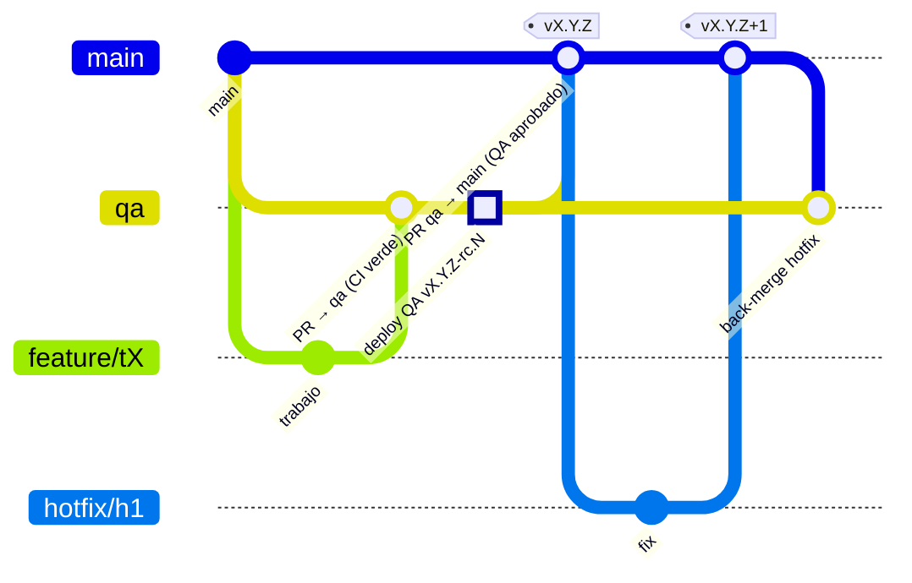

# ADR-0017: Estrategia de ramas main / qa / feature / hotfix

- Estado: Aceptado (decisión del usuario, 2026-11-19) · Fecha: 2026-11-19
- Reemplaza la sección "Flujo Git" (trunk-based) de ADR-0013. El resto de ADR-0013 (controles
  DevSecOps, Environments, mismo artefacto en PROD) sigue vigente.

## Contexto
El usuario definió un flujo con una rama de integración `qa` separada de `main`, con
validación en el ambiente de calidad antes de llegar a producción.

## Decisión

### Ramas
| Rama | Propósito | Recibe cambios de |
|---|---|---|
| `main` | Estable, aprobada para producción | PR desde `qa` (tras aprobación de QA) o desde `hotfix/*` |
| `qa` | Integración y validación en el ambiente de calidad | PR desde `feature/*`; back-merge de `main` tras un hotfix |
| `feature/*` | Una funcionalidad o tarea del roadmap (`feature/t1.5-sqlc`) | Commits del desarrollo; nace de `qa` |
| `hotfix/*` | Corrección urgente de producción | Nace de `main` |

### Flujo

1. `feature/*` nace de `qa`. Se ejecutan las pruebas locales (`task check`,
   `task test:integration`) antes de pedir integración.
2. PR `feature/*` → `qa`: CI obligatorio (unitarias, integración, lint/SAST, govulncheck,
   gitleaks, Trivy). Merge solo con autorización del usuario.
3. Cada merge en `qa` construye **una imagen inmutable** (GHCR, referenciada por digest) con
   versión identificable `vX.Y.Z-rc.N` (tag Git + label OCI con commit).
4. Despliegue de esa imagen al Droplet QA (Fase 3 en adelante), con aprobación del usuario en
   el GitHub Environment `qa` y secretos propios de QA.
5. Validación en QA: funcionalidades, integraciones, permisos, seguridad, comportamiento.
   Resultado registrado en `docs/testing/test-results.md` y `docs/operations/qa-deployment.md`.
6. Solo con QA aprobado: PR `qa` → `main`. Al hacer merge se crea el tag `vX.Y.Z` que
   **apunta al mismo digest** validado en QA (se re-etiqueta, no se reconstruye).
7. Despliegue PROD (desde la Fase 13) del mismo digest, con Environment `prod`, secretos
   propios de PROD y aprobación explícita.
8. Hotfix: `hotfix/*` desde `main` → PR a `main` → despliegue → **back-merge obligatorio a
   `qa`** para evitar divergencias.

### Protecciones (GitHub)
- `main` y `qa`: sin push directo, sin force-push ni borrado, PR obligatorio con CI verde,
  historial lineal (squash para `feature/*` → `qa`; merge commit para `qa` → `main` para
  conservar la trazabilidad de releases).
- Nota: en repositorios **privados** con plan GitHub Free, las reglas de protección y los
  rulesets no se aplican; requieren GitHub Pro/Team (ver pending-questions P23).

### Autorizaciones
Ningún merge, commit, push, creación de PR ni despliegue sin autorización explícita del
usuario. Claude Code tiene una regla `ask` para `git push` en su configuración local.

## Consecuencias
- (+) Validación explícita en QA antes de producción; PROD usa exactamente lo validado.
- (−) Más pasos por cambio y riesgo de divergencia `qa`/`main`, mitigado con el back-merge
  obligatorio de hotfix y releases frecuentes.
- Durante las Fases 1–2 (sin Droplet QA) la rama `qa` funciona como rama de integración con
  CI; el despliegue a QA empieza en la Fase 3.
