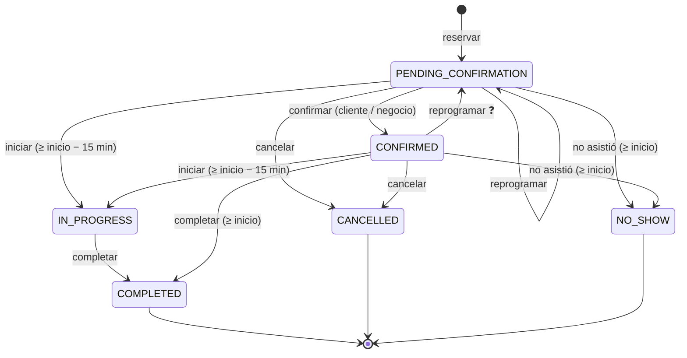

# Ciclo de vida de las citas

Estado: **Propuesta — Fase 0.** Las reglas marcadas con ❓ dependen de
`docs/plan/pending-questions.md`.

## 1. Estados

| Estado | Ocupa agenda | Terminal | Significado |
|---|---|---|---|
| `PENDING_CONFIRMATION` | Sí | No | Reservada, el cliente aún no confirmó asistencia |
| `CONFIRMED` | Sí | No | Cliente (o negocio) confirmó |
| `IN_PROGRESS` | Sí | No | El profesional inició el servicio |
| `COMPLETED` | No* | Sí | Servicio prestado |
| `CANCELLED` | No | Sí | Cancelada por cliente, negocio o sistema |
| `NO_SHOW` | No | Sí | El cliente no asistió |

\* Una cita completada ya pasó; liberar el resto del rango si se completa antes es aceptable.

## 2. Máquina de estados



**Implementado en T6.6** (`scheduling/domain/transitions.go`): cancelar y reprogramar solo antes
de la hora de inicio; "no vino" desde la hora de inicio y libera el resto del horario; solo el
OWNER reasigna a otro profesional; reprogramación por el negocio → pendiente si el cliente tiene
cuenta, confirmada si no.

Implementación original propuesta: tabla de transiciones en el dominio
(`map[Status]map[Action]Status` + guardas temporales y de actor). Cualquier transición no listada
devuelve `ErrInvalidTransition` → HTTP 409.

## 3. Quién puede hacer qué

| Acción | Cliente (dueño de la cita) | Profesional (asignado) | Manager / Owner | Admin plataforma |
|---|---|---|---|---|
| Reservar | Sí (para sí mismo) | Sí (manual) | Sí (manual) | No |
| Confirmar | Sí | Sí | Sí | No |
| Cancelar | Sí, hasta `cancellationCutoffHours` | Sí | Sí | No |
| Reprogramar | Sí, hasta `rescheduleCutoffHours` y hasta `maxCustomerReschedules` veces por cita (T7.8) | Sí (sin límite; no cuenta) | Sí (sin límite; no cuenta) | No |
| Iniciar / Completar / No-show | No | Sí | Sí | No |
| Ver historial | Propio | De sus citas | Del negocio | Auditoría |

Un profesional solo actúa sobre citas de **su** agenda (salvo rol MANAGER/OWNER).

## 4. Flujo principal

```mermaid
sequenceDiagram
    participant C as Cliente
    participant API
    participant DB as PostgreSQL
    participant W as Worker River
    C->>API: GET /availability
    API->>DB: horario, bloqueos, citas
    API-->>C: slots
    C->>API: POST /appointments (Idempotency-Key)
    API->>DB: BEGIN; lock profesional; revalidar; INSERT; encolar jobs; COMMIT
    API-->>C: 201 PENDING_CONFIRMATION
    W->>W: notificar profesional (push) + confirmación inicial al cliente (WhatsApp/push)
    W->>W: recordatorio programado (inicio − 24 h)
    C->>API: confirmar (app o botón WhatsApp)
    API->>DB: UPDATE status=CONFIRMED WHERE version=?
    W->>W: notificar profesional
```

## 5. Reglas de negocio

1. **Validación doble**: la disponibilidad se recalcula dentro de la transacción de reserva.
2. **Snapshot**: al reservar se copian nombre, precio, moneda y duración del servicio, y el
   `bufferMinutes` vigente del negocio. Cambios posteriores del catálogo no afectan la cita.
3. **Reprogramación**: misma cita (mismo `id`), nuevo `startAt`/`endAt`; se registra en
   `appointment_events`; se invalidan recordatorios y tokens de acción anteriores (por `version`).
   Se puede cambiar de profesional dentro del mismo negocio si está habilitado para el servicio.
   No cambia el servicio (para eso: cancelar y reservar). Estado tras reprogramar (P7, decidido 2026-11-24):
   → vuelve a `PENDING_CONFIRMATION` si reprograma el negocio; queda `CONFIRMED` si reprograma
   el propio cliente.
4. **Cancelación**: registra quién, por qué y cuándo. Libera el horario inmediatamente (el
   exclusion constraint deja de aplicar al salir de los estados activos).
5. **Sin cancelación automática** de citas pendientes en el MVP. Las citas no confirmadas siguen
   ocupando la agenda; el negocio decide. Una política de auto-cancelación requiere aprobación
   explícita (❓).
6. **Confirmaciones repetidas** son idempotentes: confirmar una cita ya `CONFIRMED` responde 200
   sin cambios ni notificaciones nuevas.
7. **Concurrencia de transiciones**: `UPDATE … SET status=$new, version=version+1 WHERE id=$id
   AND version=$expected`; si 0 filas → recargar y reevaluar (o 409).

## 6. Reservas con menos de 24 horas de anticipación (propuesta ❓)

| Antelación al reservar | Comportamiento propuesto |
|---|---|
| < `minLeadMinutes` (def. 60 min) | Rechazada (`422 LEAD_TIME_TOO_SHORT`). |
| Entre `minLeadMinutes` y 24 h | No se programa recordatorio D-1. El mensaje de **creación** incluye el botón "Confirmar asistencia". Estado inicial `PENDING_CONFIRMATION`. |
| ≥ 24 h | Mensaje de creación sin botón; recordatorio con botón a `inicio − 24 h`. |
| Reserva manual del negocio (cliente presente o por teléfono) | El negocio puede crearla directamente como `CONFIRMED`. |

El recordatorio se programa en `max(inicio − reminderHoursBefore, ahora + 5 min)` solo si queda
al menos 1 h antes del inicio; en otro caso, no se envía.

## 7. No asistencia

Solo marcable a partir de la hora de inicio, por el profesional o el negocio. Se registra para
estadísticas futuras; sin penalización automática en el MVP.
