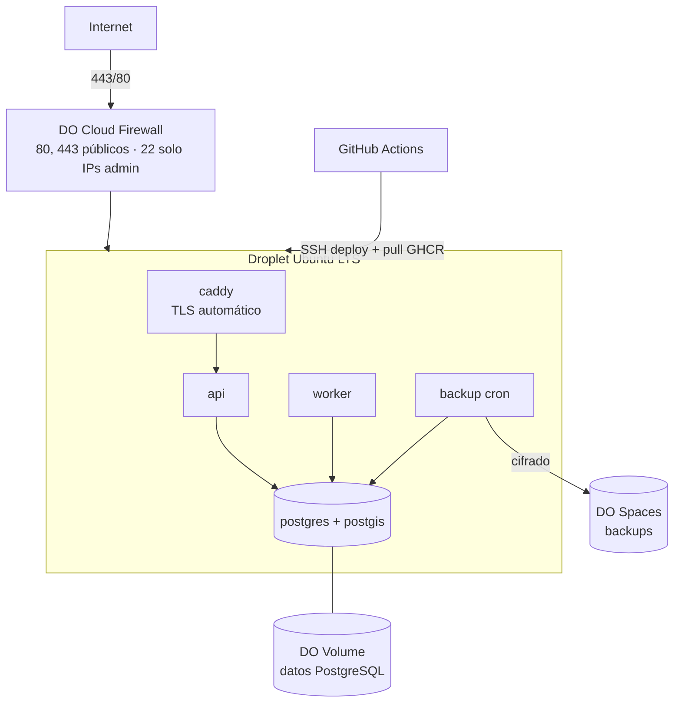

# Despliegue en DigitalOcean

Estado: **QA en construcción (Fase 3).** ADR-0012. Droplet QA `booking-qa` creado por el
usuario (2026-11-22); preparación en `docs/operations/server-bootstrap.md`. Ningún recurso con
costo adicional sin autorización explícita.

## 1. Topología por ambiente (QA y PROD idénticos, separados)

## 2. Dimensionamiento inicial y costo estimado (a confirmar con precios vigentes)

| Recurso | QA | PROD (inicio) |
|---|---|---|
| Droplet | 2 vCPU / 2–4 GB RAM | 2 vCPU / 4 GB RAM |
| Volume | 10–25 GB | 25–50 GB |
| Spaces (backups) | Bucket compartido por cuenta con prefijos y llaves distintas ❓, o bucket por ambiente | Bucket propio |
| Backups de Droplet DO | Opcional | Recomendado |
| Monitoreo | DO Monitoring (gratis) + uptime check | DO Monitoring + uptime check + alertas |

Los precios se verificarán en el panel de DigitalOcean antes de solicitar autorización en Fase 3.

## 3. Endurecimiento del Droplet

- Ubuntu LTS vigente, `unattended-upgrades` activado.
- Usuario no-root `deploy`; `PermitRootLogin no`, `PasswordAuthentication no`; llaves ed25519.
- Firewall de DO + `ufw` como segunda capa; PostgreSQL **no** expuesto (solo red interna Docker).
  Docker publica puertos por fuera de ufw: solo Caddy publica puertos (80/443). El Cloud
  Firewall de DO no se gestiona con las herramientas disponibles; en QA queda solo `ufw` (P36).
- Caddy (T3.3) es el único servicio expuesto; la API solo confía en `X-Forwarded-For` de la IP
  fija de Caddy (`TRUSTED_PROXIES`).
- `fail2ban` para SSH.
- Docker con contenedores no-root, `read_only`, `no-new-privileges`, límites de memoria.
- Secretos en `/opt/booking/<env>/.env` con permisos `0600`, propiedad de `deploy`.

## 4. Procedimiento de despliegue (pipeline)

Implementado para QA en T3.4/T3.5 (`release-qa.yml` + `deploy/server/deploy.sh`; detalle en
`docs/operations/qa-deployment.md`).

1. Imagen construida y escaneada en CI, publicada en GHCR con tag del commit y digest. El stack
   de Compose viaja **dentro de la imagen** (`/deploy/qa/`).
2. GitHub Environment (`qa`: solo la rama `qa`; sin aprobadores, no disponibles en repos
   privados del plan Free — QA se despliega automáticamente en cada merge).
3. SSH al Droplet con llave de CI restringida a un comando fijo → `pull` por digest con token
   efímero.
4. Backup previo a migraciones (`pg_dump`).
5. `docker compose run --rm api migrate up` con usuario `app_migrator`.
6. `docker compose up -d api worker`.
7. Smoke tests: `/healthz`, `/readyz`, login con usuario sintético (solo QA), versión expuesta.
8. Registro del despliegue (digest, commit, fecha, actor) en `docs/operations/` y en el
   resumen del workflow.
9. Fallo → rollback automático al digest anterior (ver `docs/operations/rollback.md`).

## 5. Alternativas consideradas

- **DO App Platform**: menos control y mayor costo por componente; descartado para MVP.
- **DO Managed PostgreSQL**: backups/PITR gestionados a costo adicional; **recomendado para PROD**
  si el presupuesto lo permite (❓ decisión en Fase 13).
- **Kubernetes (DOKS)**: excluido por el prompt maestro y por sobreingeniería.
