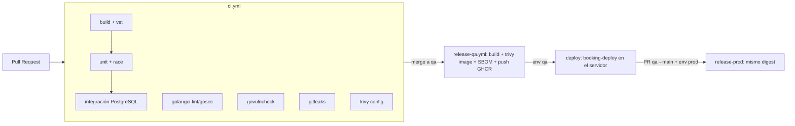

# DevSecOps: Git, GitHub y CI/CD

Estado: **Propuesta — Fase 0.** ADR-0012 y ADR-0013. La base mínima (gitleaks, Dependabot,
plantilla de PR) se incorpora en Fase 0; el pipeline completo, en Fase 1; despliegue QA, en
Fase 3; PROD, en Fase 13.

## 1. Flujo Git (ADR-0017)

- Ramas permanentes: `main` (estable, producción) y `qa` (integración y validación en QA).
- Ramas temporales: `feature/<tarea>` (nacen de `qa`) y `hotfix/<tema>` (nacen de `main`).
- No se desarrolla sobre `main` ni `qa`. Todo entra por Pull Request con CI verde y
  autorización explícita del usuario.
- `feature/*` → PR → `qa` → imagen `vX.Y.Z-rc.N` → despliegue QA → validación → PR `qa` →
  `main` → tag `vX.Y.Z` sobre el **mismo digest** → despliegue PROD (Fase 13).
- Hotfix: `hotfix/*` → PR → `main` → back-merge obligatorio a `qa`.
- Conventional Commits; un PR por tarea del roadmap, referenciando su ID (`T1.5`).
- Protección de `main` y `qa`: PR obligatorio, checks obligatorios (`ci`, `security`), sin
  push directo, sin force-push ni borrado. Requiere GitHub Pro/Team en repos privados (P23).
- Commits firmados (recomendado, ❓).
- Versiones desplegadas, pruebas y resultados se registran en `docs/operations/*` y
  `docs/testing/test-results.md`.

## 2. Seguridad en cada etapa ("shift left")

| Etapa | Control | Herramienta |
|---|---|---|
| Editor / pre-commit | Secretos, formato | `pre-commit` + gitleaks, gofmt/goimports |
| PR – código | SAST | `golangci-lint` con `gosec`, `staticcheck`, `errcheck`, `depguard` (fronteras de módulos) |
| PR – código | Análisis semántico (si el repo es público o con GHAS) | CodeQL ❓ |
| PR – dependencias | Vulnerabilidades alcanzables | `govulncheck` |
| PR – dependencias | Actualizaciones | Dependabot (gomod, github-actions, docker) |
| PR – secretos | Historial completo | gitleaks (CI) + GitHub secret scanning / push protection |
| PR – IaC / Docker | Misconfiguraciones | Trivy `config` (Dockerfile, compose) |
| Build | Imagen mínima | Multi-stage, `distroless/static` no-root, `CGO_ENABLED=0`, `-trimpath` |
| Build | Vulnerabilidades de imagen | Trivy `image` (falla en HIGH/CRITICAL con fix disponible) |
| Build | Cadena de suministro | SBOM CycloneDX (Trivy) como artefacto del workflow; se publica la misma imagen escaneada, referenciada por digest; firma con cosign keyless ❓ (PROD) |
| Deploy | Secretos | GitHub Environments (`qa`, `prod`) con política de rama; secretos por ambiente (revisores requeridos no disponibles en repos privados del plan Free) |
| Deploy | Verificación | Migraciones → smoke tests → registro del despliegue |
| Runtime | Superficie | Firewall, SSH solo con llave, puertos de BD cerrados, Caddy TLS, contenedores no-root, `read_only` |
| Runtime | Detección | Logs estructurados, auditoría, alertas de health check |

## 3. Endurecimiento de GitHub Actions

- `permissions:` mínimos por workflow (`contents: read` por defecto).
- Acciones de terceros **fijadas por SHA** (Dependabot las actualiza). En Fase 0 el workflow de
  gitleaks usa tags de versión; se fijan por SHA en Fase 1.
- Sin `pull_request_target` con checkout de código del PR.
- Despliegues solo desde la rama del ambiente (`qa` → QA; `main` → PROD, ADR-0017) mediante la
  política de rama del Environment.
- Acceso al Droplet por SSH con llave dedicada de CI guardada como secreto del Environment y
  restringida en `authorized_keys` (`restrict,command=`) a un script fijo de root que solo
  acepta imágenes de este repositorio en GHCR por digest; host key fijada en un secreto.
- Token de registro: el `GITHUB_TOKEN` efímero del job, enviado por stdin; el servidor no guarda
  credenciales de GHCR.
- Imágenes en **GHCR** (`ghcr.io/<owner>/booking-platform-backend`) referenciadas por digest.

## 4. Pipelines



Archivos: `.github/workflows/ci.yml`, `security.yml` (programado semanal + PR), `release-qa.yml`
(T3.4/T3.5); `release-prod.yml` en la Fase 13.

## 5. Lo que existe hoy (T1.8)

Todos en la raíz de este repositorio (`booking-platform-backend`, ADR-0016). El repositorio
frontend tendrá su propia configuración equivalente.

| Archivo | Propósito |
|---|---|
| `.gitignore`, `.gitattributes`, `.editorconfig` | Evitar secretos/binarios versionados; LF consistente |
| `.pre-commit-config.yaml` | Hook gitleaks local |
| `.gitleaks.toml` | Configuración de gitleaks (reglas por defecto + token de sesión propio) |
| `.github/workflows/ci.yml` | PR y push a `qa`/`main`: `test` (build, vet, `go mod verify`, unitarias con `-race`, cobertura), `integration` (testcontainers PostGIS, `-race`), `lint` (golangci-lint v2.15.0 con gosec/depguard, `sqlc vet` + `sqlc diff`) |
| `.github/workflows/security.yml` | PR, push a `qa`/`main`, semanal y manual: `secrets` (gitleaks historial completo), `vuln` (govulncheck), `container` (Trivy config + build + Trivy imagen HIGH/CRITICAL) |
| `.github/dependabot.yml` | Actualizaciones (Actions por SHA, gomod, docker, compose) contra `qa` |
| `.github/pull_request_template.md` | Checklist de calidad y seguridad por PR |
| `SECURITY.md` | Política de reporte de vulnerabilidades |

Fijación de versiones:
- Acciones por SHA de commit con la versión en comentario: checkout v7.0.1, setup-go v7.0.0
  (v7.1.0 descartada por tener < 2 semanas), upload-artifact v7.0.2, golangci-lint-action v9.3.0.
- Escáneres como imágenes Docker fijadas por digest (no como acciones): gitleaks v8.30.1,
  Trivy 0.76.2. Las mismas versiones se usan localmente (`task secrets`, `task trivy`).
- Herramientas Go fijadas: golangci-lint v2.15.0, sqlc v1.31.1, govulncheck v1.10.0.
- Las imágenes referenciadas dentro de `run:` no las actualiza Dependabot: revisarlas en cada
  cierre de fase.

## 6. Publicación en GitHub (cuando el usuario lo autorice)

```bash
# Desde booking-platform-backend/. Requiere: repo PRIVADO vacío (sin README) creado en GitHub
# y autorización explícita para el push.
git remote add origin git@github.com:<owner>/booking-platform-backend.git
git push -u origin main
```

Después del primer push: activar branch protection (o rulesets), Dependabot alerts y security
updates, private vulnerability reporting, y crear los Environments `qa` y `prod`.

Nota sobre repositorio **privado**: en cuentas sin GitHub Advanced Security / Secret Protection,
CodeQL y el secret scanning nativo con push protection no están disponibles (verificar el plan
vigente). Por eso gitleaks (pre-commit + CI), gosec y govulncheck son los controles obligatorios.
La protección de ramas en repos privados requiere plan GitHub Pro/Team; si no se tiene, se
aplica por disciplina y por los checks del CI (❓ confirmar plan de la cuenta).
