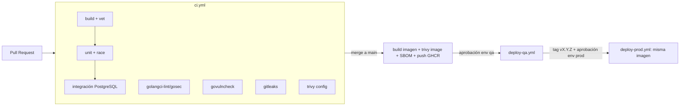

# DevSecOps: Git, GitHub y CI/CD

Estado: **Propuesta — Fase 0.** ADR-0012 y ADR-0013. La base mínima (gitleaks, Dependabot,
plantilla de PR) se incorpora en Fase 0; el pipeline completo, en Fase 1; despliegue QA, en
Fase 3; PROD, en Fase 13.

## 1. Flujo Git

- **Trunk-based**: `main` siempre desplegable a QA.
- Ramas cortas: `feat/<tarea>`, `fix/…`, `docs/…`, `chore/…`, `ci/…`.
- Conventional Commits; un PR por tarea del roadmap, referenciando su ID (`T1.3`).
- Reglas de protección de `main` en GitHub (configurar al crear el repo):
  - PR obligatorio, 1 aprobación (el propietario), resolución de conversaciones.
  - Checks obligatorios: `ci / build-test`, `ci / lint`, `security / secrets`, `security / vuln`.
  - Sin force-push ni borrado; historial lineal (squash merge).
  - Commits firmados (recomendado, ❓).
- Releases: tags SemVer `vX.Y.Z` → imagen inmutable; PROD despliega solo tags ya validados en QA.

## 2. Seguridad en cada etapa ("shift left")

| Etapa | Control | Herramienta |
|---|---|---|
| Editor / pre-commit | Secretos, formato | `pre-commit` + gitleaks, gofmt/goimports |
| PR – código | SAST | `golangci-lint` con `gosec`, `staticcheck`, `errcheck`, `depguard` (fronteras de módulos) |
| PR – código | Análisis semántico (si el repo es público o con GHAS) | CodeQL ❓ |
| PR – dependencias | Vulnerabilidades alcanzables | `govulncheck` |
| PR – dependencias | Actualizaciones | Dependabot (gomod, github-actions, docker) |
| PR – secretos | Historial completo | gitleaks (CI) + GitHub secret scanning / push protection |
| PR – IaC / Docker | Misconfiguraciones | Trivy `config` (Dockerfile, compose) |
| Build | Imagen mínima | Multi-stage, `distroless/static` no-root, `CGO_ENABLED=0`, `-trimpath` |
| Build | Vulnerabilidades de imagen | Trivy `image` (falla en HIGH/CRITICAL con fix disponible) |
| Build | Cadena de suministro | SBOM (Syft, SPDX) adjunto al release; firma de imagen con cosign keyless (OIDC) ❓ |
| Deploy | Secretos | GitHub Environments (`qa`, `prod`) con revisores requeridos; secretos por ambiente |
| Deploy | Verificación | Migraciones → smoke tests → registro del despliegue |
| Runtime | Superficie | Firewall, SSH solo con llave, puertos de BD cerrados, Caddy TLS, contenedores no-root, `read_only` |
| Runtime | Detección | Logs estructurados, auditoría, alertas de health check |

## 3. Endurecimiento de GitHub Actions

- `permissions:` mínimos por workflow (`contents: read` por defecto).
- Acciones de terceros **fijadas por SHA** (Dependabot las actualiza). En Fase 0 el workflow de
  gitleaks usa tags de versión; se fijan por SHA en Fase 1.
- Sin `pull_request_target` con checkout de código del PR.
- Despliegues solo desde `main`/tags y con GitHub Environment protegido.
- Acceso al Droplet por SSH con llave dedicada de despliegue (usuario `deploy`, sin sudo
  general) guardada como secreto del Environment.
- Imágenes en **GHCR** (`ghcr.io/<owner>/booking-platform-backend`) referenciadas por digest.

## 4. Pipelines



Archivos previstos: `.github/workflows/ci.yml`, `security.yml` (programado semanal + PR),
`release-image.yml`, `deploy-qa.yml`, `deploy-prod.yml`.

## 5. Lo que existe hoy (Fase 0)

Todos en la raíz de este repositorio (`booking-platform-backend`, ADR-0016). El repositorio
frontend tendrá su propia configuración equivalente.

| Archivo | Propósito |
|---|---|
| `.gitignore`, `.gitattributes`, `.editorconfig` | Evitar secretos/binarios versionados; LF consistente |
| `.pre-commit-config.yaml` | Hook gitleaks local |
| `.gitleaks.toml` | Configuración de gitleaks (reglas por defecto + token de sesión propio) |
| `.github/workflows/secret-scan.yml` | gitleaks en cada push/PR |
| `.github/dependabot.yml` | Actualizaciones de GitHub Actions |
| `.github/pull_request_template.md` | Checklist de calidad y seguridad por PR |
| `SECURITY.md` | Política de reporte de vulnerabilidades |

## 6. Publicación en GitHub (cuando el usuario lo autorice)

```bash
# Desde booking-platform-backend/. Requiere: repo PRIVADO vacío (sin README) creado en GitHub
# y autorización explícita para el push.
git remote add origin git@github.com:<owner>/booking-platform-backend.git
git push -u origin main
```

Después del primer push: activar branch protection (o rulesets), Dependabot alerts y security
updates, private vulnerability reporting, y crear los Environments `qa` y `prod`.

Nota sobre repositorio **privado**: en cuentas sin GitHub Advanced Security / Secret Protection,
CodeQL y el secret scanning nativo con push protection no están disponibles (verificar el plan
vigente). Por eso gitleaks (pre-commit + CI), gosec y govulncheck son los controles obligatorios.
La protección de ramas en repos privados requiere plan GitHub Pro/Team; si no se tiene, se
aplica por disciplina y por los checks del CI (❓ confirmar plan de la cuenta).
