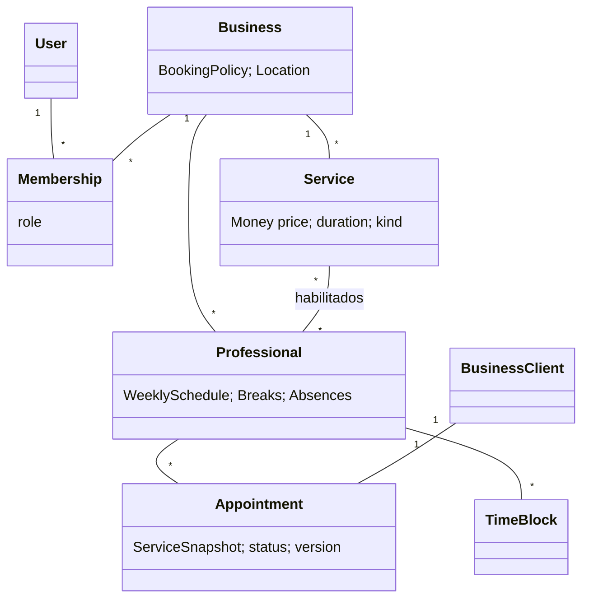

# Modelo de dominio

Estado: **Propuesta — Fase 0, pendiente de aprobación.**

Convención: **(A)** = raíz de agregado, **(E)** = entidad interna, **(VO)** = value object.

## 1. Value Objects compartidos

Viven en el dominio de cada módulo que los use (o en un paquete `internal/platform/kernel`
mínimo si se repiten; se decidirá en Fase 1 evitando un "shared kernel" grande).

| VO | Reglas |
|---|---|
| `Email` | Normalizado a minúsculas, sin espacios, formato RFC 5322 simplificado, ≤ 254 caracteres. |
| `PhoneNumber` | Formato E.164 (`+573001234567`). Validación con libphonenumber en la capa de aplicación. |
| `Money` | `amountMinor int64` ≥ 0 + `Currency` (ISO 4217). Nunca `float`. Operaciones solo entre la misma moneda. |
| `Currency` | Código ISO 4217 de 3 letras, de una lista permitida. |
| `TimeZone` | Nombre IANA válido (`time.LoadLocation` debe funcionar). |
| `Duration` (minutos) | Entero 5–480. **No se redondea** al intervalo. |
| `SlotInterval` | Uno de {5, 10, 15, 20}. Por defecto 10. |
| `BufferTime` | Entero 0–60 minutos. |
| `TimeRange` | `[start, end)` en UTC; `start < end`. Operaciones: `Overlaps`, `Contains`, `Subtract`. |
| `LocalTimeRange` | Hora local `HH:MM`–`HH:MM` (sin fecha) para horarios semanales; `start < end`, sin cruzar medianoche en MVP. |
| `Coordinates` | Lat ∈ [-90, 90], Lng ∈ [-180, 180]. Opcional. |
| `Slug` | `[a-z0-9-]{3,60}`, único globalmente. |

## 2. Identity & Access

- **User (A)**: `id`, `email`, `phone?`, `passwordHash`, `fullName`, `status`
  (`PENDING_VERIFICATION`, `ACTIVE`, `SUSPENDED`), `isPlatformAdmin`, `locale`, timestamps.
  - Invariantes: email único; usuario `SUSPENDED` no puede autenticarse; la contraseña cumple
    política (≥ 8 caracteres, no en una lista pequeña de contraseñas comunes; decisión P31).
- **Session (A)**: `id`, `userId`, `tokenHash` (SHA-256), `clientType` (`MOBILE`, `WEB`),
  `createdAt`, `lastSeenAt`, `idleExpiresAt`, `absoluteExpiresAt`, `revokedAt?`, `ip`, `userAgent`.
  - Invariantes: sesión válida ⇔ no revocada ∧ `now < idleExpiresAt` ∧ `now < absoluteExpiresAt`.
- **PasswordResetToken (A)**: `tokenHash`, `userId`, `expiresAt` (30 min), `usedAt?`. Un solo uso.
- **Membership (A)**: `userId`, `businessId`, `role` (`OWNER`, `PROFESSIONAL`; MANAGER eliminado en T5.1),
  `status`. Un usuario puede tener membresías en varios negocios (p. ej. dueño de dos locales).
  - Invariante: cada negocio tiene **al menos un** `OWNER` activo. El OWNER es el responsable
    del negocio y puede haber varios (decisión del usuario, 2026-11-24, T4.5): un responsable
    agrega otros responsables y barberos (`PROFESSIONAL`); el cambio de dueño es
    asignar al nuevo responsable y luego retirar al anterior.
- **AuditEntry**: registro inmutable (actor, acción, recurso, business_id, IP, resultado, fecha).

Los clientes finales son `User` sin membresía; el rol `CUSTOMER` es implícito.

## 3. Geography (datos de referencia)

- **Country**: `code` (ISO 3166-1 alfa-2, PK), `name`, `phoneCode`, `defaultCurrency`, `active`.
- **AdministrativeDivision**: `id`, `countryCode`, `code?` (ISO 3166-2), `name`, `type`
  (departamento / estado / provincia / región), `active`.
- **City**: `id`, `divisionId`, `name`, `timeZone` (IANA por defecto para negocios), `active`.
- Invariante: no se desactiva una ciudad con negocios activos sin migrarlos.

Gestionado solo por `PLATFORM_ADMIN`; se siembra con un seed de los países del piloto.

## 4. Businesses

- **Business (A)**:
  - `id`, `name`, `slug`, `status` (`PENDING_REVIEW`, `ACTIVE`, `SUSPENDED`), `contactPhone`,
    `description`.
  - `Location` (VO): `countryCode`, `divisionId`, `cityId`, `addressLine`, `coordinates?`,
    `timeZone`.
  - `BookingPolicy` (VO):
    - `slotInterval` (5/10/15/20, def. 10)
    - `bufferMinutes` (0–60, def. 0)
    - `minLeadMinutes` (antelación mínima para reservar, def. 60)
    - `maxAdvanceDays` (horizonte, def. 60)
    - `cancellationCutoffHours` (cliente puede cancelar hasta N h antes, def. 2)
    - `rescheduleCutoffHours` (def. 2)
    - `requireCustomerConfirmation` (def. `true`)
  - `NotificationSettings` (VO): canales habilitados, envío de recordatorio (def. 24 h antes).
    Implementado en T4.2 como `Reminders{Enabled, HoursBefore 1–72}`; los canales llegan en la
    Fase 7.
  - Invariantes: la ciudad pertenece a la división y la división al país; `timeZone` válido;
    negocio `SUSPENDED` no acepta reservas nuevas ni aparece en búsquedas.
- Eventos: `BusinessRegistered`, `BusinessActivated`, `BusinessSuspended`, `BookingPolicyChanged`.

## 5. Professionals

- **Professional (A)**: `id`, `businessId`, `userId?`, `displayName`, `bio`, `status`
  (`ACTIVE`, `INACTIVE`), `sortOrder`.
  - `WeeklySchedule` (E): por día de la semana, lista de `LocalTimeRange` de trabajo.
  - `RecurringBreak` (E): día de la semana + `LocalTimeRange` (p. ej. almuerzo).
  - `Absence` (E): `TimeRange` en UTC (vacaciones, incapacidad) + motivo.
  - Invariantes: rangos del mismo día no se solapan; un descanso está contenido en un rango de
    trabajo; un profesional pertenece a un solo negocio; un `userId` tiene a lo sumo un perfil
    de profesional por negocio.
- Eventos: `ProfessionalCreated`, `ProfessionalDeactivated`, `ScheduleChanged`, `AbsenceAdded`.

## 6. Catalog

- **ServiceCategory (A)**: `id`, `businessId`, `name`, `sortOrder`, `active`.
- **Service (A)**: `id`, `businessId`, `categoryId`, `name`, `description`, `price: Money`,
  `duration`, `kind` (`SINGLE`, `COMBO`), `componentServiceIds` (solo informativo en COMBO),
  `status` (`ACTIVE`, `INACTIVE`), `enabledProfessionalIds`.
  - Invariantes: nombre único por negocio; moneda = moneda del negocio; un combo tiene precio y
    duración propios (no se calculan); profesionales habilitados pertenecen al mismo negocio;
    categoría del mismo negocio.
- **No existe catálogo global.**

## 7. Scheduling (core domain)

- **Appointment (A)**:
  - `id`, `businessId`, `professionalId`, `clientId` (→ `BusinessClient`), `bookedByUserId`,
    `channel` (`CUSTOMER_APP`, `BUSINESS_PORTAL`, `PROFESSIONAL_APP`).
  - `ServiceSnapshot` (VO): `serviceId`, `name`, `priceMinor`, `currency`, `durationMinutes`.
  - `startAt`, `endAt` (= start + duración), `bufferMinutes` (snapshot), `status`, `version`.
  - `cancellation?`: `by` (`CUSTOMER`, `BUSINESS`, `SYSTEM`), `reason`, `at`.
  - `notes` (internas del negocio).
  - Invariantes: ver `booking-lifecycle.md`; `endAt - startAt = snapshot.duration`; transiciones
    solo según la máquina de estados; snapshot inmutable.
- **AppointmentEvent (E)**: historial inmutable (tipo, estado anterior/nuevo, horario
  anterior/nuevo, actor, fecha).
- **TimeBlock (A)**: `id`, `businessId`, `professionalId`, `range: TimeRange`, `reason`,
  `createdBy`. Bloqueo puntual de agenda.
- **BusinessClient (A)**: `id`, `businessId`, `userId?`, `fullName`, `phone?`, `email?`,
  `notes`. Representa al cliente **dentro de un negocio**: se crea automáticamente al reservar
  desde la app o manualmente desde el portal (clientes sin cuenta). Unicidad por
  `(businessId, userId)` y por `(businessId, phone)`.
- **AgendaShareLink (A)**: `id`, `businessId`, `professionalId`, `scope` (`DAY_AGENDA`,
  `APPOINTMENT`), `resourceRef`, `tokenHash`, `expiresAt`, `revokedAt?`. Acceso de solo lectura
  y datos mínimos.
- **Servicio de dominio `AvailabilityCalculator`**: función pura que recibe horario, descansos,
  ausencias, bloqueos, citas, duración, política y `now`, y devuelve slots. Ver
  `availability-engine.md`.
- Eventos: `AppointmentBooked`, `AppointmentConfirmed`, `AppointmentStarted`,
  `AppointmentCompleted`, `AppointmentCancelled`, `AppointmentRescheduled`,
  `AppointmentMarkedNoShow`.

## 8. Notifications

- **Device (A)**: `id`, `userId`, `platform` (`IOS`, `ANDROID`), `pushToken`, `appKind`
  (`CUSTOMER`, `PROFESSIONAL`), `lastSeenAt`, `revokedAt?`. Token único.
- **Consent (A)**: `subject` (userId o clientId), `channel` (`WHATSAPP`, `PUSH`), `phone?`,
  `granted`, `source`, `policyVersion`, `grantedAt`, `revokedAt?`. Sin consentimiento vigente no
  se envía WhatsApp.
- **NotificationPreference**: por usuario/cliente y tipo de evento (recordatorios on/off).
- **NotificationMessage (A)**: `id`, `businessId`, `appointmentId?`, `channel`, `template`,
  `recipientRef`, `status` (`QUEUED`, `SENT`, `DELIVERED`, `READ`, `FAILED`, `SKIPPED`),
  `providerMessageId?`, `attempts`, `lastError?`, `idempotencyKey` (único).
- **AppointmentActionToken**: token opaco de un solo uso para botones de WhatsApp
  (`confirm`/`cancel`) ligado a cita + versión + teléfono destino; expira al inicio de la cita.
- **WebhookEvent**: `provider`, `eventId` (único), `receivedAt`, `processedAt?`, `payloadHash`.

## 9. Diagrama de agregados

Las referencias entre agregados son **por ID**, nunca por objeto.
