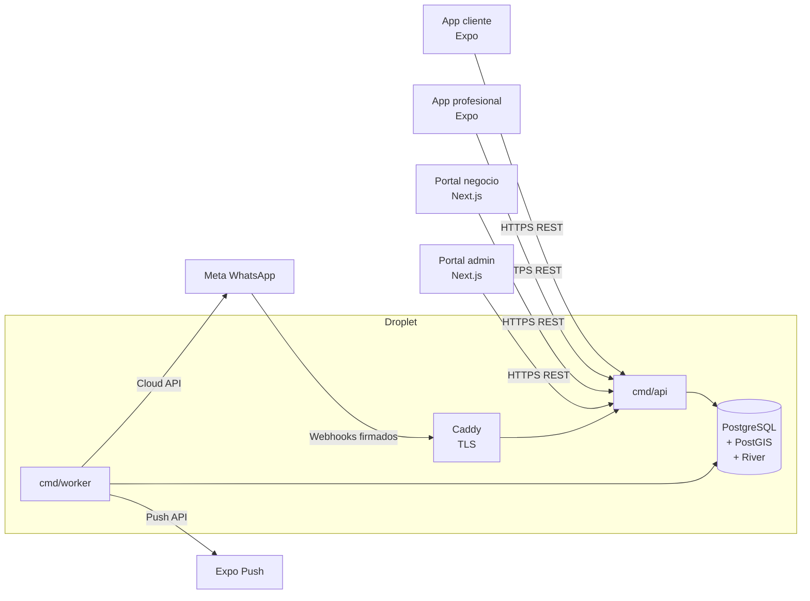
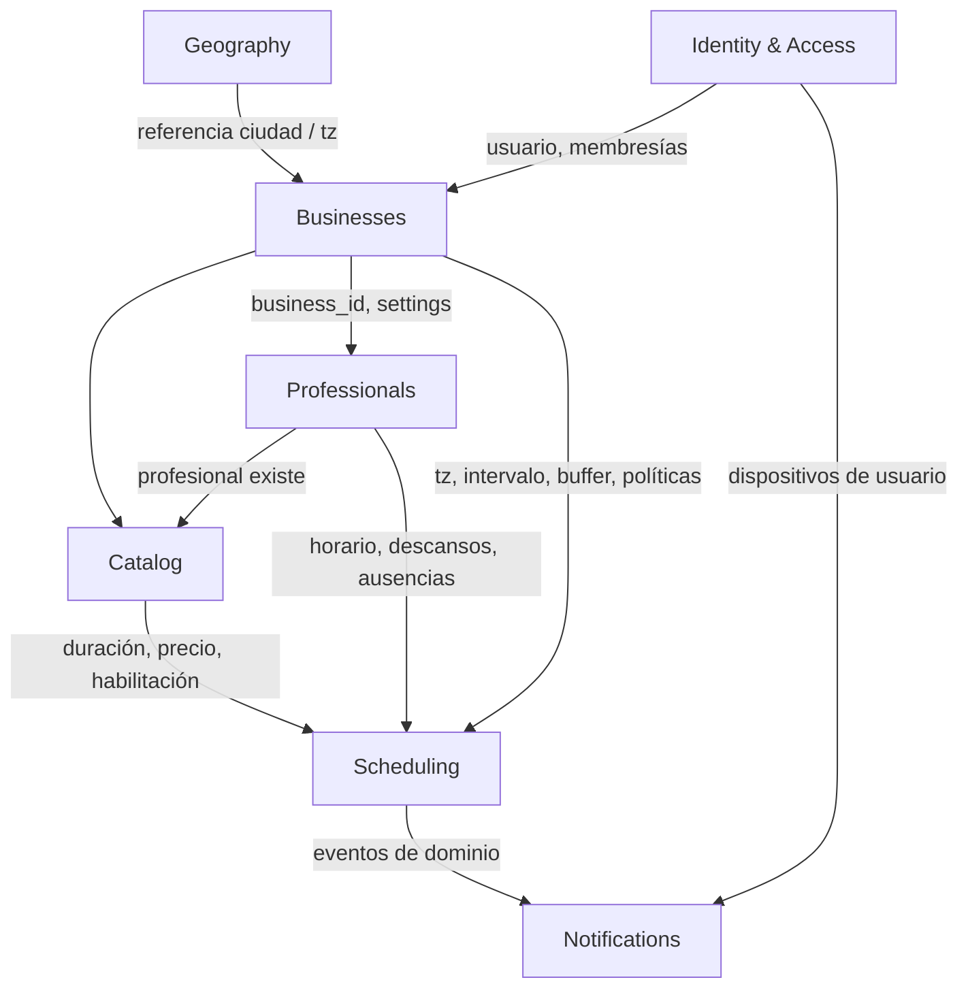

# Arquitectura general

Estado: **Propuesta — Fase 0, pendiente de aprobación.**

## 1. Estilo arquitectónico

**Monolito modular en Go** con Domain-Driven Design y Clean Architecture (ADR-0002).

- Un repositorio, un `go.mod`, dos binarios desplegables:
  - `cmd/api`: servidor HTTP REST.
  - `cmd/worker`: procesador de jobs River (notificaciones, recordatorios, webhooks).
- Una base de datos PostgreSQL (con PostGIS). Cada módulo es dueño de sus tablas; ningún módulo
  escribe tablas de otro.
- La frontera entre módulos se respeta en el código (paquetes `contract`) y se verifica con
  reglas de lint (`depguard`) — ver sección 5.

Por qué no microservicios: equipo pequeño, dominio aún en descubrimiento, y la operación crítica
(reservar) necesita transacciones ACID locales. Un monolito modular bien delimitado permite
extraer módulos más adelante si llega a hacer falta.

## 2. Diagrama de contexto



## 3. Bounded contexts

| # | Contexto | Responsabilidad | Agregados principales |
|---|---|---|---|
| 1 | **Identity & Access** (`identity`) | Usuarios, credenciales, sesiones, recuperación de contraseña, membresías y roles, auditoría | `User`, `Session`, `Membership` |
| 2 | **Geography** (`geography`) | Países, divisiones administrativas, ciudades, zonas horarias | `Country`, `AdministrativeDivision`, `City` (datos de referencia) |
| 3 | **Businesses** (`businesses`) | Negocio, ubicación, estado, configuración de reservas y notificaciones | `Business` |
| 4 | **Professionals** (`professionals`) | Perfil del profesional, horario semanal, descansos recurrentes, ausencias | `Professional` |
| 5 | **Catalog** (`catalog`) | Categorías, servicios (individuales/combinados), precios, duraciones, profesionales habilitados | `ServiceCategory`, `Service` |
| 6 | **Scheduling** (`scheduling`) | Disponibilidad, citas, bloqueos, clientes del negocio, historial, enlaces compartidos | `Appointment`, `TimeBlock`, `BusinessClient` |
| 7 | **Notifications** (`notifications`) | WhatsApp, push, dispositivos, consentimientos, preferencias, plantillas, webhooks | `Device`, `Consent`, `NotificationMessage` |

Relaciones (context map):



Scheduling es el **núcleo** (core domain). El resto son subdominios de soporte o genéricos.

## 4. Capas dentro de cada módulo

```
internal/modules/<modulo>/
├── domain/          # Entidades, VO, agregados, invariantes, eventos de dominio, errores de dominio.
│                    # Sin dependencias externas salvo stdlib y google/uuid.
├── application/     # Casos de uso (commands / queries), puertos (interfaces de repositorio,
│                    # reloj, publicador de eventos), políticas de autorización del caso de uso.
├── infrastructure/  # Implementación de puertos: repositorios pgx+SQLC, adaptadores externos.
├── interfaces/http/ # Handlers, DTO, validación de entrada, mapeo de errores, rutas.
└── contract/        # API pública del módulo para otros módulos (interfaces + DTO de lectura).
```

Reglas de dependencia:

- `domain` → nada.
- `application` → `domain`, `contract` de **otros** módulos.
- `infrastructure` → `application`, `domain`, `internal/platform`.
- `interfaces/http` → `application`, `internal/platform/httpx`.
- Ningún módulo importa `domain`/`application`/`infrastructure` de otro módulo.
- Sin dependencias circulares entre `contract`.
- Los handlers **no** contienen lógica de negocio; las entidades **nunca** se serializan
  directamente (siempre DTO).

## 5. Estructura de carpetas propuesta

```text
booking-platform-backend/
├── CLAUDE.md  README.md  SECURITY.md  Taskfile.yml  go.mod
├── cmd/
│   ├── api/main.go            # composition root HTTP
│   └── worker/main.go         # composition root River
├── internal/
│   ├── app/                   # wiring de módulos (construcción de dependencias)
│   ├── platform/              # cross-cutting técnico, sin lógica de negocio
│   │   ├── config/  db/  logging/  httpx/  clock/  ids/  jobs/  audit/  ratelimit/
│   └── modules/
│       ├── identity/  geography/  businesses/  professionals/
│       └── catalog/   scheduling/  notifications/
├── db/
│   ├── migrations/            # Goose (SQL), embebidas en el binario
│   └── queries/<modulo>/*.sql # SQLC
├── api/openapi.yaml           # contrato OpenAPI 3.1 (fuente de verdad)
├── tests/
│   ├── integration/           # suites end-to-end de API contra PostgreSQL real
│   ├── security/              # IDOR, cross-tenant, tokens, webhooks falsificados
│   └── concurrency/           # doble reserva, carreras de estado
├── deploy/
│   ├── docker/Dockerfile
│   └── compose/docker-compose.dev.yml
├── .github/workflows/
└── docs/
```

Notas:
- El prompt maestro sugiere `migrations/` en la raíz; se propone `db/migrations/` junto a
  `db/queries/` para agrupar todo lo de SQLC/Goose. Cambio menor, a confirmar.
- Las pruebas unitarias van junto al código (`*_test.go`); `tests/` es solo para suites
  transversales.
- La infraestructura QA/PROD (Caddy, compose de servidor, scripts) vive en
  `booking-platform/infrastructure/` (fuera de este repositorio), a partir de la Fase 3 y con
  autorización.

## 6. Componentes transversales (`internal/platform`)

| Paquete | Responsabilidad |
|---|---|
| `config` | Carga y validación de variables de entorno; falla al iniciar si falta algo. |
| `db` | Pool pgx, helper de transacciones (`WithTx`), mapeo de errores PostgreSQL. |
| `logging` | `slog` JSON, request ID, redacción de campos sensibles. |
| `httpx` | Router (`net/http` stdlib), middleware (recover, request-id, logging, CORS, rate limit, auth), RFC 9457. |
| `clock` | Interfaz `Clock` para tiempo determinista en pruebas. |
| `ids` | Generación UUIDv7. |
| `jobs` | Cliente River y registro de workers. |
| `audit` | Escritura de registros de auditoría. |

## 7. Eventos de dominio

Los agregados registran eventos (`AppointmentBooked`, `AppointmentConfirmed`,
`AppointmentCancelled`, `AppointmentRescheduled`, …). El caso de uso, **dentro de la misma
transacción** que persiste el agregado, despacha los eventos a manejadores in-process que
encolan jobs River con `InsertTx` (outbox transaccional nativo, ADR-0008). Si la transacción
falla, no se encola nada; si el proveedor externo falla, la reserva ya está confirmada y el job
reintenta.

## 8. Atributos de calidad y cómo se abordan

| Atributo | Mecanismo |
|---|---|
| Integridad de reservas | Bloqueo por profesional + exclusion constraint (ADR-0004) |
| Aislamiento multiempresa | `business_id` en toda tabla de negocio, autorización por recurso, pruebas cross-tenant (ADR-0007) |
| Seguridad | Argon2id, tokens opacos hasheados, RBAC, rate limiting, auditoría (ADR-0006) |
| Resiliencia de notificaciones | River con reintentos/backoff, idempotencia (ADR-0008) |
| Mantenibilidad | Módulos con contratos explícitos, dominio puro, pruebas automatizadas |
| Operabilidad | Logs JSON, health/readiness, migraciones versionadas, backups probados |
